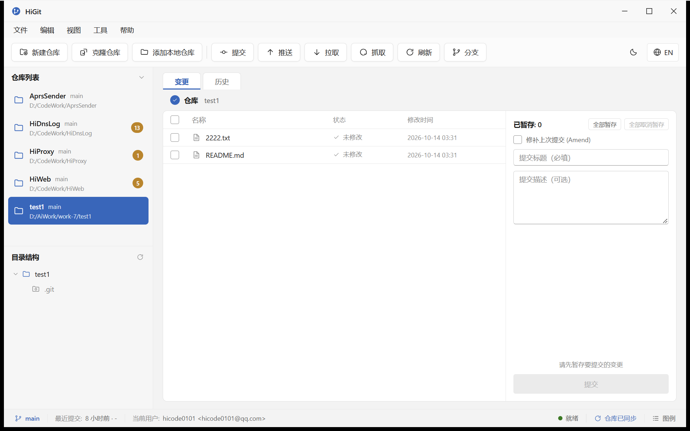

<div align="center">


# HiGit

**零依赖 · 跨平台 · Fluent 风格的图形化 Git 客户端**

[](https://v2.tauri.app)
[](https://vuejs.org)
[](https://www.typescriptlang.org)
[](https://www.rust-lang.org)
[](https://libgit2.org)

*A zero-dependency, cross-platform Git client. Tauri 2 (Vue 3 + TypeScript) UI with a Rust backend — no Git installation required.*



</div>

---

## ✨ 功能特性

### 仓库管理

- **三种入口**：新建空仓库（可选初始化 README、内置语言 `.gitignore` 模板）、从 URL 克隆（目标目录占用检测、进度与取消）、添加本地已有仓库；
- **仓库列表**：显示名称 / 路径 / 分支 / 待提交变更徽标，支持**拖拽排序**、右键菜单（拉取、推送、抓取、打开所在文件夹、仓库设置、从列表移除）；
- **欢迎页**：未打开仓库时展示新建 / 克隆 / 添加三入口卡片；启动自动恢复上次打开的仓库。

### 变更与提交

- 文件状态表：复选框暂存切换、类型图标、Git 状态着色（新增 / 修改 / 删除 / 重命名 / 冲突 / 已忽略）、修改时间；
- 批量操作：全部暂存 / 全部取消暂存、丢弃更改（**二次确认**，支持多选）；
- 提交对话框：勾选文件决定本次提交内容、标题 72 字符校验、**Amend 修补上次提交**（自动预填上次消息）、冲突文件"提交即视为已解决"提示；
- 提交面板实时显示已暂存数量与身份配置状态，未配置身份时弹出**引导对话框**。

### 同步（推送 / 拉取 / 抓取）

- **同步对话框**：集中选择远端与分支，实时输出分级日志（remote / ok / warn / error…），任务可取消；
- 推送支持**多分支 refspec**、无上游时自动建立上游、**强制推送**（高风险二次确认）；
- 拉取 / 抓取可选远端与分支，抓取一次取回远端所有分支；
- 每个本地分支展示领先 / 落后计数，状态栏同步状态可点击直达对应操作。

### 分支管理

- 本地 / 远端分支列表（当前分支高亮）；新建分支（自定义起点、创建后立即切换）、重命名、删除（含未合并提交时强删警告）、检出、**合并**（快进 / 常规合并，冲突时列出冲突文件）。

### 历史与差异

- 提交历史分页加载，支持按**消息 / 作者 / hash** 过滤；
- 提交详情：作者、日期、父提交、变更文件列表；支持查看**提交内单文件差异**；
- 差异查看器：统一 / 并排双视图；二进制文件提示、超大文件（> 1 MB）仅显示统计、差异行数过多自动截断。

### 身份与凭证

- **Git 身份**：全局与仓库级 `user.name` / `user.email` 独立配置，仓库留空自动跟随全局；
- **凭证**：HTTP 用户名 / 密码（或 Token）、SSH 密钥文件 + 口令（显式配置的密钥优先；引擎无法解析的格式如 OpenSSH/ed25519 容器、PuTTY `.ppk`、PKCS#8 会自动跳过并回退 ssh-agent，日志提示具体原因；留空则依次尝试 ssh-agent 与默认密钥）；
- **URL 识别**：仓库设置 / 克隆对话框修改远端 URL 时自动切换认证方式——`https://host/用户名/...` → HTTPS（用户名自动预填），`git@host:path` / `ssh://user@host/...` → SSH（用户名取 @ 前的值，缺省 `git`）；
- 凭证优先级：会话内存 → 系统凭证管理器（勾选"记住"）→ 凭证对话框；认证失败自动弹出凭证框并**原地重试**当前任务。

### 个性化与系统集成

- 浅 / 深 / **跟随系统**主题（CSS 变量驱动），中英双语**热切换**；
- 网络代理**开关**（默认地址 `socks5://127.0.0.1:1080`），开启后作用于克隆 / 抓取 / 推送 / 拉取，关闭直连；
- **自动刷新**：notify 文件监听 300 ms 防抖，watcher 与写任务互斥，可开关；"显示忽略文件"开关；
- 文件监听之外还能：打开所在文件夹、打开系统终端、用系统编辑器编辑 `.gitignore`、打开配置目录、**导出诊断日志**；
- 完整菜单栏（文件 / 编辑 / 视图 / 工具 / 帮助）+ 全局快捷键 + 快捷键一览对话框。

## 🖥 界面布局

主界面（变更 / 仓库列表 / 目录结构 / 状态栏）对齐原型图：

| 区域 | 内容 |
| --- | --- |
| 工具栏 | 新建 / 克隆 / 添加本地仓库 · 提交 · 推送 · 拉取 · 抓取 · 刷新 · 分支 · 主题 · 语言 |
| 仓库列表 | 名称 / 路径 / 分支 / 待提交徽标；拖拽排序；右键：同步操作、打开文件夹、仓库设置、移除 |
| 目录结构 | 懒加载目录树（面包屑导航，`.git` 特殊标识），点击定位文件列表 |
| 文件表 | 复选框（暂存切换）/ 名称（类型图标）/ Git 状态 / 修改时间；双击看差异；右键：暂存 / 取消暂存 / 查看差异 / 丢弃更改 |
| 提交面板 | 已暂存计数 · 全部暂存 / 取消 · Amend 勾选 · 标题 / 描述 · 提交按钮 |
| 状态栏 | 分支（点击管理）/ 最近提交 / 当前用户 / 任务状态 / 同步状态（领先/落后可点击）/ 图例 |

## ⌨️ 快捷键

| 快捷键 | 功能 |
| --- | --- |
| `Ctrl+N` | 新建仓库 |
| `Ctrl+Shift+C` | 克隆仓库 |
| `Ctrl+,` | 打开设置 |
| `Ctrl+B` | 显示 / 隐藏侧栏 |
| `Esc` | 关闭对话框 / 差异视图 |

> 帮助菜单内含完整快捷键一览。

## 🚀 开发与构建

要求：Rust 1.85+、Node.js 18+（pnpm）。无需系统安装 Git（libgit2 静态链接）。

```bash
pnpm install            # 安装前端依赖
pnpm tauri dev          # 开发运行（vite dev server + tauri）
pnpm tauri build        # 发布构建（Windows 产出 NSIS 安装包等）
cargo test --workspace  # 全量测试（49 项，见下）
```

**测试构成（49 项）**：git2 引擎冒烟 28 · 引擎单元 10（差异统计 3 + SSH 凭证 6 + 凭证相等性 1）· 应用配置 7 · gitignore 模板 3 · 凭证存储 1

> 注意：若本机 1420 端口被保留策略限制（Windows 排除端口段），`pnpm tauri dev` 会报
> `listen EACCES`；可在 `vite.config.ts` 与 `src-tauri/tauri.conf.json` 中改用其他端口。

### 📦 自动发布（GitHub Actions）

推送 `v*` 格式的 tag（如 `v1.2.3`）即触发 [`.github/workflows/release.yml`](.github/workflows/release.yml)：
先用 `scripts/sync-version.mjs` 把 tag 版本号同步到三处版本源——`src-tauri/tauri.conf.json`
（安装包元数据与“关于”对话框显示的版本）、根 `Cargo.toml` 的 `[workspace.package].version`
（exe 程序集属性）、`package.json`——再构建安装包并自动发布同版本号的 GitHub Release。

| 平台 | Runner | 产物 |
| ---- | ------ | ---- |
| Windows | windows-latest | NSIS / MSI 安装包 |
| macOS Apple Silicon | macos-latest（原生） | App / DMG（aarch64） |
| macOS Intel | macos-latest（M 系列上交叉编译） | App / DMG（x86_64） |
| Linux | ubuntu-22.04 | deb / rpm / AppImage |

版本号只接受 `x.y.z` 纯数字三段式（MSI 不支持预发布后缀），因此请使用 `v1.2.3` 这类纯版本 tag。

## 📁 目录结构

```
HiGit/
├── src/                    # Vue 3 前端
│   ├── api/                #   invoke 封装 + DTO 类型 + 事件监听
│   ├── i18n/               #   en（键 = 原文）/ zh-CN 资源，运行时热切换
│   ├── styles/             #   主题 token（浅/深）+ 基础样式
│   ├── components/         #   标题栏 / 菜单栏 / 工具栏 / 侧栏 / 文件表 / 提交面板
│   │                       #   历史视图 / 差异视图 / 同步对话框 / 分支管理 / 欢迎页 / 对话框
│   ├── store.ts            #   全局状态（配置 / 仓库 / 状态 / 任务 / 对话框）
│   └── tasks.ts            #   动作层（长任务事件 / 暂存 / 提交 / 同步）
├── src-tauri/              # Tauri 2 应用层（47 个 command / state / dto / platform）
├── crates/
│   ├── higit-git/          # GitEngine trait + git2 后端（含 SSH 凭证、代理、取消）
│   └── higit-core/         # 配置 / 系统凭证管理器 / gitignore 语言模板
├── docs/                   # logo 与截图
└── tauri.conf.json 等
```

## 🏗 架构约定

- **CR-1**：`git2` 类型不越出 `higit-git` crate，应用层只见 `GitEngine` trait 与纯 DTO，未来可经 `BackendKind` 切换 gix / CLI 后端；
- 长任务（克隆 / 推送 / 拉取 / 抓取）在独立线程执行，通过事件上报进度与分级日志，支持取消；watcher 与写任务互斥，避免刷新风暴；
- 错误模型 `HigitError { code, params, raw }` 结构化上抛，前端按错误码 i18n 渲染、原文可复制；
- 凭证优先级：会话内存 → 系统凭证管理器（"记住"勾选）→ 凭证对话框；
- 配置存储于系统标准配置目录（Windows `%APPDATA%\HiGit\config.json`），损坏时自动回退默认设置。
